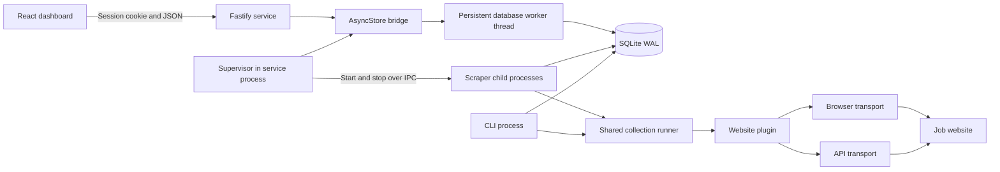
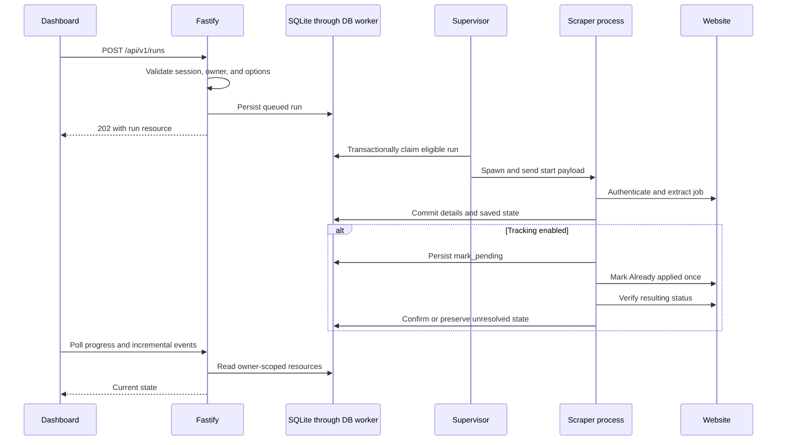

# Architecture

## Scope

The application runs on one machine with Node.js 24, Fastify, Playwright Chromium, SQLite, and a React frontend. It supports multiple backend users and saved job-site connections, called **profiles** in the UI. Both the dashboard and the CLI reuse the same collection engine and website plugins.

SQLite is authoritative for collected jobs, work requests, progress, and backend sessions. There is no external message broker or distributed worker service.

## Runtime components

| Component | Responsibility | Source |
| --- | --- | --- |
| React application | Authentication screens, profiles, run controls, job browsing, admin user management | [`web/src/`](../web/src/) |
| Fastify service | Validation, session checks, ownership, resource APIs, OpenAPI, static frontend hosting | [`src/service/app.js`](../src/service/app.js) |
| Supervisor | Claim queued work, enforce capacity, spawn workers, cancel, recover, and record unexpected exits | [`src/service/supervisor.js`](../src/service/supervisor.js) |
| Database bridge | Promise-based calls to synchronous SQLite operations on a persistent thread | [`src/storage/async-store.js`](../src/storage/async-store.js), [`db-worker.js`](../src/storage/db-worker.js) |
| Managed worker | Acquire account lock, prepare credentials/browser, run a plugin, persist progress, clean up | [`src/service/worker.js`](../src/service/worker.js) |
| Collection runner | Extract, persist, update website tracking, verify, and reconcile pending updates | [`src/core/runner.js`](../src/core/runner.js) |
| Website plugins | Authentication, selectors, HTTP endpoints, response validation, normalization | [`plugins/`](../plugins/) |
| Storage | Schema migrations, job persistence, user ownership, durable queue, and events | [`src/storage/`](../src/storage/) |

The database worker keeps synchronous SQLite waits off the HTTP event loop. Scrapers use their own database connections inside child processes. WAL and short transactions coordinate these connections; website requests never run inside database transactions.

## Collection request flow

Authentication-only operations use the same queue and process management without collecting jobs. A finite collection completes when its saved-job limit is reached. An unlimited collection waits for new recommendations until stopped.

## Concurrency, cancellation, and recovery

The default capacity is two managed workers globally and one executing worker per backend user. Database constraints prevent concurrent execution against the same site/account, including accounts shared across users. A filesystem account lock coordinates managed workers with CLI runners. A service lock prevents two supervisors using the same data directory.

Multiple profiles may have queued runs, but a connection can have only one queued or active operation. Duplicate submissions return a conflict containing the existing run ID.

Stopping queued work finishes it without launching a process. Stopping active work persists `stop_requested` and sends IPC cancellation to its `AbortController`. Workers stop scheduling new jobs, verify an update already sent when possible, and close resources. After the default 30-second allowance, the supervisor terminates that worker's owned process tree.

Queued work survives restart. Abandoned managed operations become `interrupted`; workers also abort when their supervisor disconnects. Retry creates a new linked run rather than rewriting history. Pending website updates are reconciled before any further changes. See [lifecycle details](data-model.md#run-lifecycle).

## Authentication and ownership boundaries

Backend authentication uses asynchronous scrypt password hashing and revocable, server-side sessions with a 24-hour default lifetime. The browser receives an HttpOnly, SameSite cookie scoped to `/api/v1`. State-changing requests require an allowed Origin; login is rate limited.

Job-site credentials are separate. They are encrypted using AES-256-GCM with a local service key and bound to the owning user, website, and account. The supervisor decrypts only the credentials needed for a worker and sends them over IPC. Workers do not inherit the entire service environment or encryption key.

Resource queries include the authenticated user's ID. Administrator privileges permit backend user management, while another user's profiles, jobs, runs, and events remain inaccessible. A supplied resource ID is never an ownership grant.

Browser sessions and diagnostics are isolated by user and connection. The frontend stores neither tokens nor job-site passwords in localStorage and clears private query caches on session changes.

## Browser and API transports

Both transports implement the same plugin contract and return a shared job structure. Browser mode reads rendered content and performs UI tracking changes. API mode uses confirmed website requests and the authenticated browser context's HTTP client/cookie jar. Browser-assisted authentication is still available in API mode; job operations do not silently fall back to scraping.

The core controls ordering and recovery. Plugins control website-specific behavior. [Website plugins](website-plugins.md) describes that boundary in detail.

## Frontend structure and hosting

`App.jsx` defines login, protected layout, dashboard, profiles, runs, jobs, detail pages, and the administrator route. `auth.jsx` bootstraps the session before private content appears. `api.js` handles cookie-authenticated requests and consistent errors. `data.js` owns reusable TanStack Query hooks, URL filters/cursors, live runs, and bounded event history. Shared UI lives in `components.jsx`; pages and CSS tokens have separate files.

The production build is served by Fastify at `http://127.0.0.1:3000`. Frontend routes support direct navigation and refresh. Missing API resources and assets remain 404s; `/docs`, `/health`, and `/ready` retain their service behavior. API-only startup works without a frontend build.

During development, Vite runs at `http://127.0.0.1:5173` and proxies API/health traffic. It rewrites Origin only for the exact trusted local frontend origin. Dependencies share the root npm lockfile through the `web/` workspace.

This architecture currently targets a single local machine. Public hosting, distributed workers, automatic schedules, employer application submission, and a separate message broker are outside the implemented scope.
