# Data model and state

The primary database is `data/jobs.sqlite`, or the database under a configured `DATA_DIR`. Storage uses Node's synchronous SQLite interface with WAL, foreign keys, a five-second busy timeout, and short transactions. Service requests access it through the database worker thread; scraper processes open their own connections.

## Identity and ownership

A backend **user** owns job-site **connections**. The React UI calls a connection a **profile**; there is no separate profile table. A connection identifies one website/account and stores its encrypted credentials and authentication state.

Job identity is connection-specific because matching information can differ by account. Managed records use the connection ID as `scope_key`, with uniqueness on `(scope_key, source_job_id)`. The source ID is a website string; the SQLite `jobs.id` is a separate integer used by API detail routes.

The CLI resolves an imported account's `cli_default` connection when available. Otherwise it uses `legacy:<site>:<account-key>` as its scope and leaves ownership unassigned. Such records are not visible to API users until explicitly imported.

## Tables

| Table | Key and main fields | Purpose |
| --- | --- | --- |
| `users` | UUID `id`; unique case-insensitive email; password hash; role; creation time | Backend identities; roles are `admin` and `user` |
| `backend_sessions` | Hashed token; owning user; expiry in epoch milliseconds | Revocable backend sessions; plaintext token is not stored |
| `connections` | UUID `id`; owner; website; account key; label; encrypted credentials; auth status; CLI mapping | Saved job-site accounts |
| `jobs` | Integer `id`; scope/owner/connection; website/source ID; URL/title/company; details/raw JSON; collection times; nullable `assigned_at` | Collected job content and local assignment |
| `job_processing` | Composite `(job_id, account_key)`; state; website status; error; update time | Local processing and external tracking state |
| `runs` | UUID `id`; owner/connection; kind/transport/options; lifecycle; counters; phase; execution metadata | Durable queue and execution history |
| `run_events` | Increasing integer `id`; run/owner; event type; JSON payload; creation time | Incremental sanitized progress history |
| `companies` | Integer `id`; owner; searchable company fields; full JSON; field timestamps | Deduplicated company metadata across a user's profiles |
| `company_identifiers` | Company/owner; kind, namespace, value | Source IDs, official domains, and normalized name aliases |
| `company_syncs` | UUID `id`; owner; status; job cutoff; durable counters and timestamps | Manual background synchronization history |

Connections are unique per `(user_id, site, account_key)`. Partial unique indexes enforce one queued/active run per connection, one executing worker per user, and one executing worker per source site/account. The supervisor separately enforces global capacity; filesystem locks also cover CLI execution.

## Job content

Frequently queried values are ordinary columns. Flexible content lives in JSON-encoded TEXT guarded by SQLite `json_valid` checks. `raw_json` may be null. A typical normalized detail object is:

```json
{
  "description": { "text": "Full original description", "html": null },
  "locations": [],
  "workArrangement": null,
  "employmentType": null,
  "seniority": null,
  "compensation": {},
  "responsibilities": [],
  "qualifications": { "required": [], "preferred": [] },
  "skills": [],
  "benefits": [],
  "education": [],
  "experience": {},
  "sponsorship": {},
  "company": {},
  "applicationUrl": null,
  "postedAt": null,
  "matching": {},
  "extra": {}
}
```

Do not invent missing facts, truncate long descriptions, infer salary currency/period, or convert relative posting text into a guessed timestamp. Browser company data can contain `name`, `text`, and `links`; API company data can contain `companyName`, `companyDesc`, and other source fields. Matching data likewise supports browser `charts` and API scores/recommendations.

`saveJob()` validates identity, URL, title, and nonempty description, then transactionally upserts content and inserts processing state if absent. It preserves the first-seen timestamp and existing processing state while updating last-scraped time and content.

Schema version 2 adds the nullable `jobs.assigned_at` column to existing version-1 databases. A timestamp means the job is locally Assigned; null means Available. Bulk assignment updates only matching jobs owned by the current user in one statement, preserving existing assignment timestamps. Re-scraping a job preserves its assignment. API summaries and details expose this as `assignedAt`; Tracking displays Assigned when present and otherwise displays the processing state. Assignment never replaces `job_processing.state`, so pending external updates and collection recovery continue to work.

List APIs omit large detail/raw columns. The job detail API parses `details_json`; `includeRaw=true` adds parsed, redacted raw data. The frontend displays text and lazily loads raw JSON. JSON/CSV exports are derived from SQLite.

## Per-job processing

```mermaid
stateDiagram-v2
    [*] --> saved: Valid content committed
    saved --> mark_pending: Record tracking intent
    mark_pending --> mark_confirmed: Website status verified applied
    mark_pending --> saved: Explicitly verified not applied
    mark_pending --> mark_pending: Result unknown; retain for reconciliation
```



`state` is local processing state; `website_status` is the last observed source tracking state. Neither is the run lifecycle. An unknown write remains pending and requires reconciliation. The runner does not blindly send it again. Confirmed jobs are excluded from subsequent collection candidates; read-only runs leave newly saved jobs in `saved`.

## Run lifecycle

```text
queued -> starting -> running -> completed
                     |
                     +-> stop_requested -> stopped

Other terminal states: failed | attention_required | interrupted
Queued cancellation: queued -> stopped
```

| State | Meaning |
| --- | --- |
| `queued` | Durable request waiting for capacity/account availability |
| `starting` | Claimed by a supervisor; process setup is underway |
| `running` | Worker is executing authentication or collection |
| `stop_requested` | Stop intent persisted; cleanup/reconciliation is in progress |
| `completed` | Authentication finished or a finite collection reached its limit |
| `stopped` | User cancellation finished, including forced shutdown when needed |
| `failed` | Known execution failure, such as an unsupported response |
| `attention_required` | Authentication intervention or unresolved external update |
| `interrupted` | Worker/supervisor exited unexpectedly |

Runs store JSON options and counters (`saved`, `confirmed`, `failed`), current phase, queue/start/end/heartbeat times, supervisor and process identity, deferred availability, stop time, sanitized errors, and a `forced` flag. Progress is persisted at least once per second while active; important job transitions are committed immediately.

Retry is allowed for stopped, failed, interrupted, and attention-required runs. It creates a new row with the same options and `parent_run_id` referencing the prior run. Historical rows are preserved. Restart keeps queued work and interrupts abandoned managed execution rather than replaying uncertain writes.

## Resource pagination

- Jobs use an opaque cursor derived from their integer ID and sort newest IDs first.
- Companies use the same descending integer-ID cursor pattern.
- Runs use an opaque cursor containing queue time and ID, with descending order.
- Events use an increasing integer `after` cursor and ascending order within a run.

Job/run page size defaults to 20 with a maximum of 100. Filters remain owner scoped. These cursors represent pagination positions, not totals or authorization. The frontend preserves list filters and pagination in the URL.

## Migrations and private files

[`migrations.js`](../src/storage/migrations.js) currently manages schema version 3 through `PRAGMA user_version`. Version 2 added local assignment; version 3 adds company storage, sync history, and nullable `jobs.company_id` without automatically linking existing jobs. See the [company directory guide](companies.md) for matching and synchronization rules. It rejects a newer unsupported version. Legacy conversion preserves full JSON and historical state, duplicates shared job rows into account scopes as needed, and records unfinished legacy runs as interrupted. Before upgrading a legacy database, it checks for live legacy runners and creates a `.pre-service.bak` backup if one is absent.

Bootstrap explicitly associates imported accounts with the administrator; unclaimed legacy data remains hidden from API users. Future schema changes must add a versioned migration rather than only altering fresh-database SQL.

Managed browser sessions live under `data/sessions/<user-id>/<connection-id>/`; diagnostics live under `artifacts/<user-id>/<connection-id>/<run-id>/`. Credentials, sessions, diagnostics, databases, and service encryption keys are local private material. Resource APIs expose none of the credential/session files. Keep the encryption key with private backups; losing it prevents decrypting saved job-site credentials.
